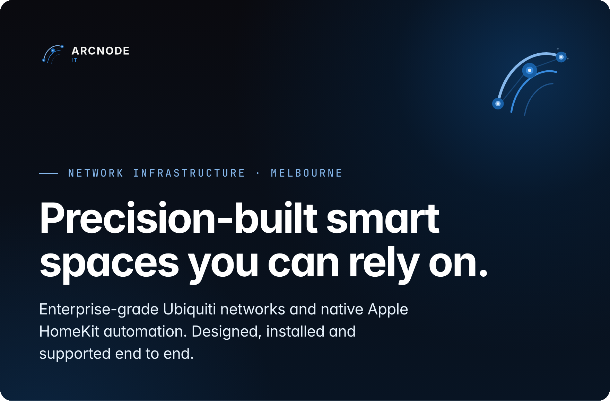
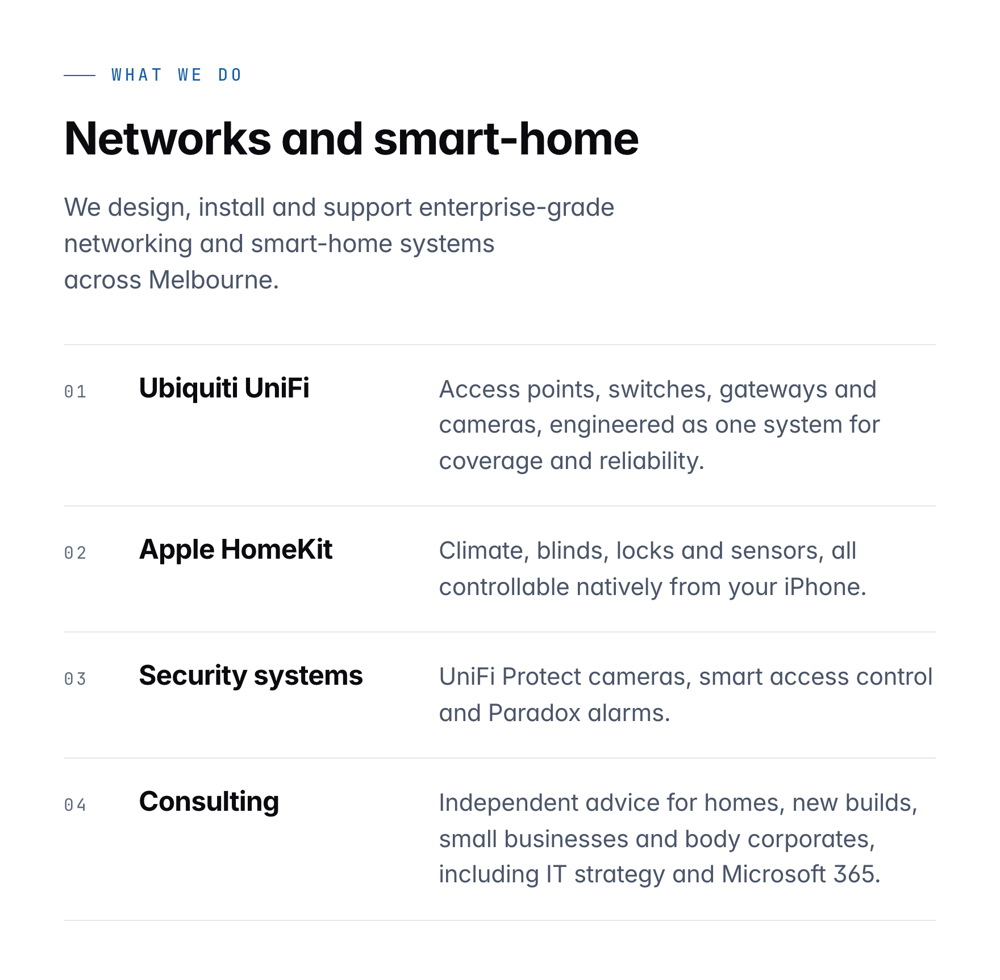
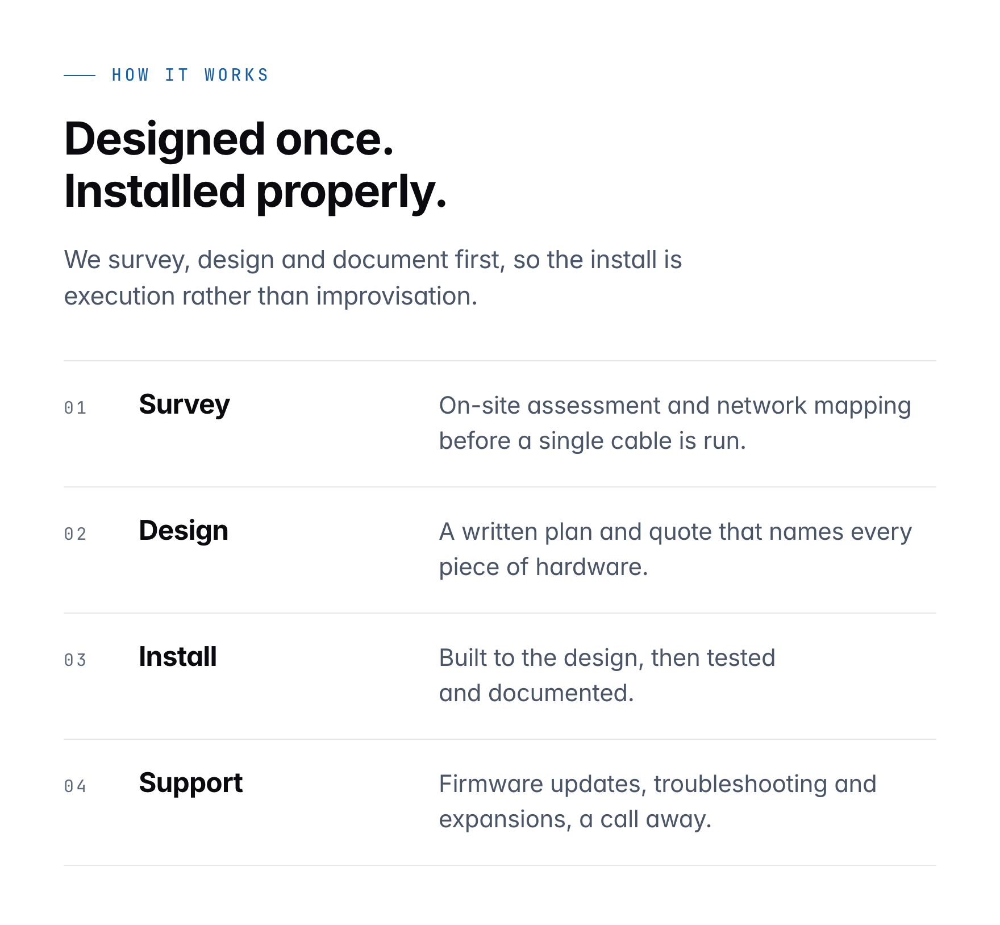

  

<picture>
  <source media="(prefers-color-scheme: dark)" srcset="https://raw.githubusercontent.com/Arcnodeit/.github/main/profile/assets/services-dark.png">
  
</picture>

  

<picture>
  <source media="(prefers-color-scheme: dark)" srcset="https://raw.githubusercontent.com/Arcnodeit/.github/main/profile/assets/process-dark.png">
  
</picture>

  

<picture>
  <source media="(prefers-color-scheme: dark)" srcset="https://raw.githubusercontent.com/Arcnodeit/.github/main/profile/assets/support-dark.png">
  
</picture>

  

