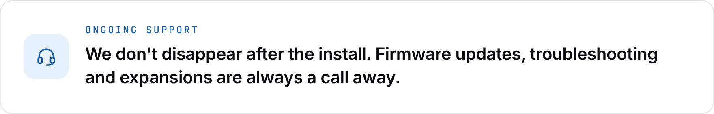
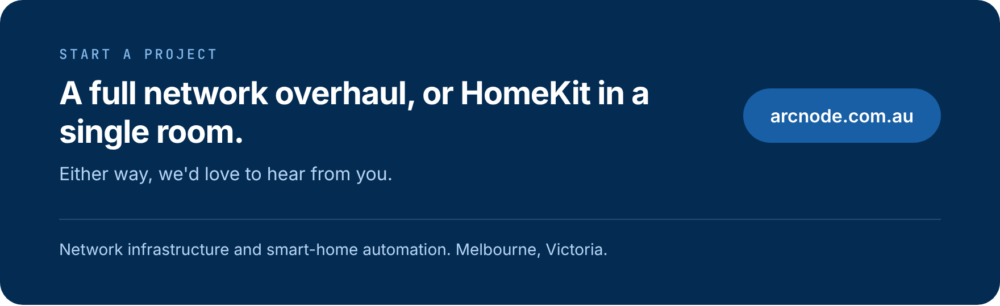

 

<picture>
  <source media="(prefers-color-scheme: dark)" srcset="https://raw.githubusercontent.com/Arcnodeit/.github/main/profile/assets/services-dark.png">
  
</picture>

  

<picture>
  <source media="(prefers-color-scheme: dark)" srcset="https://raw.githubusercontent.com/Arcnodeit/.github/main/profile/assets/process-dark.png">
  
</picture>

  

<picture>
  <source media="(prefers-color-scheme: dark)" srcset="https://raw.githubusercontent.com/Arcnodeit/.github/main/profile/assets/support-dark.png">
  
</picture>

  

 

### Arcnode IT, Melbourne

We design, install and look after networks, managed IT and smart-home automation for homes and businesses across Melbourne and Victoria.

- **Start a project:** [arcnode.com.au](https://www.arcnode.com.au) or hello@arcnode.com.au
- **Clients:** sign in to the [client portal](https://portal.arcnode.com.au) for your requests, documents and invoices
- **Support:** tickets@arcnode.com.au

Our code lives in private repositories, so there is nothing public to browse here.
